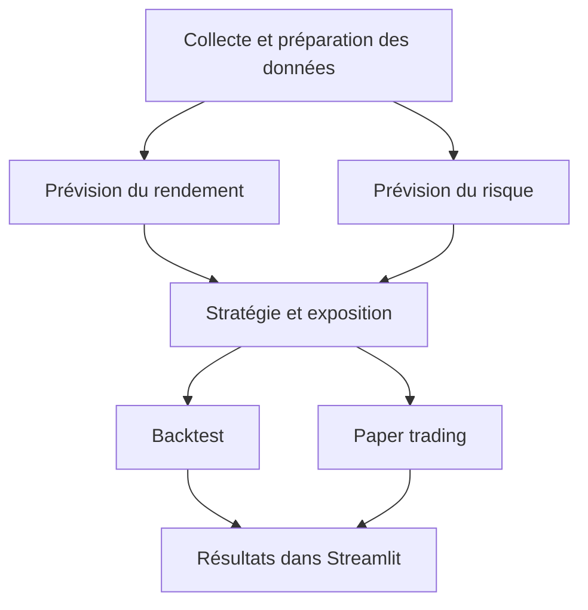

# GLD Quant Lab — D01

## Présentation

Projet du module Trading Intelligent : développer une application Streamlit pour analyser GLD, prévoir son rendement et son risque, puis tester des stratégies en simulation avec 100 000 USD virtuels. L’application permettra d’explorer les données, comparer les modèles, gérer le risque, tester les stratégies sur le passé et suivre des opérations fictives sur de nouvelles séances.

Les décisions seront prises après clôture, avec exécution au plus tôt à l’ouverture suivante, sans levier ni vente à découvert.

## Actif étudié

- **Ticker : GLD**, exposition à l’or.
- **Benchmark : SPY**, référence de comparaison.

## Question scientifique

La gestion dynamique de l’exposition fondée sur GARCH protège-t-elle mieux le capital qu’une taille fixe ?

Nous comparerons une proportion investie fixe à une proportion adaptée à la volatilité prévue par GARCH, avec les mêmes signaux et les mêmes coûts.

## Équipe et répartition proposée

| Membre | Rôle | Tâches |
|---|---|---|
| ELBENNANI Ilyass | Données et économétrie | Collecter GLD/SPY et contrôler la qualité des données ; calculer les rendements et préparer les variables ; séparer apprentissage, validation et test ; développer les références simples et ARIMA/SARIMA/SARIMAX ; comparer les prévisions et examiner les résidus ; réaliser Market Data et la partie économétrique du Model Laboratory. |
| KIRAJ WALID | Risque, stratégie et backtest | Tester les effets ARCH et prévoir la volatilité avec GARCH ; calculer et vérifier VaR/ES ; définir les décisions et les expositions fixe/dynamique ; développer le backtest avec frais et calendrier d’exécution ; analyser rendement, pertes et drawdown ; réaliser Risk Management, Trading Strategy et Backtesting. |
| ALAOUI Rida | ML/DL et intégration | Développer un modèle linéaire régularisé, un modèle arborescent et un MLP ; comparer les prévisions selon le protocole commun ; réaliser la partie ML/DL du Model Laboratory ; organiser la navigation Streamlit et intégrer les vues de chaque membre ; préparer le mode démonstration hors connexion. |
| Toute l’équipe | Travail commun | Réaliser le paper trading et le suivi du portefeuille ; définir les formats communs et vérifier l’absence de fuite d’information ; tester et documenter chaque module ; relire le code ; préparer le rapport et la soutenance. |

## Diagramme de l’application

