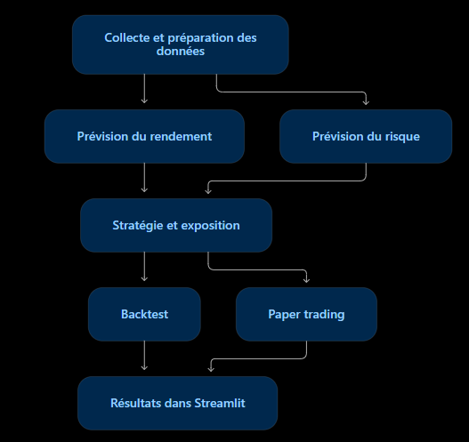

# GLD Quant Lab — D01

## Présentation

Projet du module Trading Intelligent : développer une application Streamlit pour analyser GLD, prévoir son rendement et son risque, puis tester des stratégies en simulation avec 100 000 USD virtuels. L’application permettra d’explorer les données, comparer les modèles, gérer le risque, tester les stratégies sur le passé et suivre des opérations fictives sur de nouvelles séances.

Les décisions seront prises après clôture, avec exécution au plus tôt à l’ouverture suivante, sans levier ni vente à découvert.

## Actif étudié

- **Ticker : GLD**, exposition à l’or.
- **Benchmark : SPY**, référence de comparaison.

## Question scientifique

La gestion dynamique de l’exposition fondée sur GARCH protège-t-elle mieux le capital qu’une taille fixe ?

Nous comparerons une proportion investie fixe à une proportion adaptée à la volatilité prévue par GARCH, avec les mêmes signaux et les mêmes coûts.

## Équipe et répartition proposée

| Membre            | Tâches principales                                                |
|-------------------|-------------------------------------------------------------------|
| ELBENNANI Ilyass  | Collecte et préparation des données, modèles ARIMA/SARIMA/SARIMAX |
| KIRAJ Walid       | GARCH, mesures du risque, stratégie et backtest                   |
| ALAOUI Rida       | Modèles ML/DL et interface Streamlit                              |

L’intégration, le paper trading, les tests et la documentation seront réalisés ensemble.

## Diagramme de l’application

