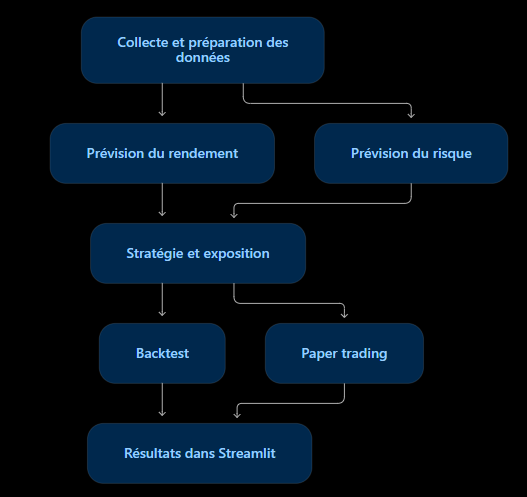

# GLD Quant Lab — D01 et D02

## Présentation

Projet du module Trading Intelligent : développer une application Streamlit pour analyser GLD, prévoir son rendement et son risque, puis tester des stratégies en simulation avec 100 000 USD virtuels. L’application permettra d’explorer les données, comparer les modèles, gérer le risque, tester les stratégies sur le passé et suivre des opérations fictives sur de nouvelles séances.

Les décisions seront prises après clôture, avec exécution au plus tôt à l’ouverture suivante, sans levier ni vente à découvert.

## Actif étudié

- **Ticker : GLD**, exposition à l’or.
- **Benchmark : SPY**, référence de comparaison.

## Question scientifique

La gestion dynamique de l’exposition fondée sur GARCH protège-t-elle mieux le capital qu’une taille fixe ?

Nous comparerons une proportion investie fixe à une proportion adaptée à la volatilité prévue par GARCH, avec les mêmes signaux et les mêmes coûts.

## Équipe et répartition proposée

| Membre | Rôle | Tâches |
|---|---|---|
| ELBENNANI Ilyass | Données et économétrie | Collecter GLD/SPY et contrôler la qualité des données ; calculer les rendements et préparer les variables ; séparer apprentissage, validation et test ; développer les références simples et ARIMA/SARIMA/SARIMAX ; comparer les prévisions et examiner les résidus ; réaliser Market Data et la partie économétrique du Model Laboratory. |
| KIRAJ WALID | Risque, stratégie et backtest | Tester les effets ARCH et prévoir la volatilité avec GARCH ; calculer et vérifier VaR/ES ; définir les décisions et les expositions fixe/dynamique ; développer le backtest avec frais et calendrier d’exécution ; analyser rendement, pertes et drawdown ; réaliser Risk Management, Trading Strategy et Backtesting. |
| ALAOUI Rida | ML/DL et intégration | Développer un modèle linéaire régularisé, un modèle arborescent et un MLP ; comparer les prévisions selon le protocole commun ; réaliser la partie ML/DL du Model Laboratory ; organiser la navigation Streamlit et intégrer les vues de chaque membre ; préparer le mode démonstration hors connexion. |
| Toute l’équipe | Travail commun | Réaliser le paper trading et le suivi du portefeuille ; définir les formats communs et vérifier l’absence de fuite d’information ; tester et documenter chaque module ; relire le code ; préparer le rapport et la soutenance. |

## Diagramme de l’application



## Organisation du livrable D02

D02 permet de montrer comment nous avons obtenu les données de GLD, comment les recharger à l’identique et comment retrouver chaque anomalie détectée. SPY reste le benchmark prévu pour les comparaisons du projet.

### Données et période d’étude

Nous récupérons auprès de Yahoo Finance, avec `yfinance`, une observation par séance de Bourse. Chaque ligne contient la date, les quatre prix ajustés en USD par part (ouverture, maximum, minimum, clôture) et le volume en parts échangées. La colonne `Date` désigne la séance de New York. La clôture et le volume total sont connus après la fin de cette séance.

| Usage prévu | Période fixée dans la configuration |
|---|---|
| Apprentissage | Du 01/01/2018 au 31/12/2022 |
| Validation | Du 01/01/2023 au 31/12/2024 |
| Test final | Du 01/01/2025 au 30/10/2026 inclus |

### Fichiers de code, de configuration et de documentation

| Fichier | Rôle dans D02 |
|---|---|
| `configs/data_config.json` | Fixe le symbole GLD, la source, la fréquence journalière, les dates et l’ajustement des prix. La date de fin exclusive `2026-10-31` inclut la séance du 30 octobre. |
| `src/data.py` | Collecte les données, crée une copie datée, puis la relit avec `load_snapshot()`. La fonction `audit_data()` calcule les compteurs des premiers contrôles. |
| `src/audit_d02.py` | Relit le CSV et ses métadonnées, compare l’empreinte SHA-256, identifie les lignes à examiner, recherche les séances manquantes et écrit la conclusion. |
| `notebooks/02_data_audit.ipynb` | Explique la démarche en Markdown, appelle les fonctions des deux modules et affiche les contrôles, les graphiques et leur interprétation pour le snapshot choisi. |
| `data/README.md` | Donne la provenance, le dictionnaire des colonnes, les unités, la convention d’ajustement et le moment où les données deviennent observables. |
| `requirements.txt` | Liste les dépendances. La collecte utilise `yfinance`, les contrôles utilisent `pandas`, la figure utilise `matplotlib` et le calendrier de référence utilise `pandas_market_calendars==5.6.1`. |
| `.gitignore` | Exclut du dépôt les fichiers locaux tels que l’environnement virtuel, les caches Python et les checkpoints Jupyter. |
| `README.md` | Présente le projet et explique comment reproduire D02 depuis la racine du dépôt. |

### Données sauvegardées

Chaque collecte crée un dossier `data/raw/GLD_<horodatage>/`. L’horodatage indique **quand** nous avons téléchargé les données, en UTC. Les dates du CSV indiquent **quelles séances** nous avons reçues.

| Fichier dans ce dossier | Contenu |
|---|---|
| `GLD_daily.csv` | Copie des données telles que retournées par `yfinance` avant notre propre nettoyage. Les prix sont déjà ajustés avec `auto_adjust=True`. |
| `metadata.json` | Source, paramètres, période demandée, première et dernière dates reçues, date d’acquisition, unités, versions des bibliothèques et empreinte SHA-256 du CSV. |

### Contrôles et rapports

L’audit compare les dates du CSV au calendrier des séances du NYSE sur **toute la période demandée**. Du 1er janvier 2018 au 30 octobre 2026 inclus, ce calendrier donne **2 220 séances attendues**. Il faut comparer les dates une à une, car un CSV de 2 220 lignes peut contenir deux fois la même date et omettre une autre séance.

L’audit recherche aussi les dates en désordre, les valeurs manquantes ou illisibles, les prix nuls ou négatifs et les incohérences entre les prix d’une même séance. Par exemple, si `High < Close`, la ligne est signalée avec ses valeurs d’origine. Un volume négatif est signalé comme anomalie. Un volume nul est signalé pour vérification.

| Fichier produit | Créé par | Ce qu’on y trouve |
|---|---|---|
| `reports/GLD_<horodatage>/quality_checks.csv` | `python -m src.data` | Les compteurs des premiers contrôles, par type de problème. |
| `reports/GLD_<horodatage>/anomalies.csv` | `audit_snapshot()` | Pour chaque signalement, le numéro de ligne du CSV, la date lue, le motif, le champ concerné, les valeurs d’origine et la vérification proposée. Une ligne peut avoir plusieurs motifs. |
| `reports/GLD_<horodatage>/seances_manquantes.csv` | `audit_snapshot()` | Les dates précises où la Bourse était ouverte et où le CSV ne contient aucune observation. |
| `reports/GLD_<horodatage>/conclusion_audit.md` | `audit_snapshot()` | Le résultat de la vérification d’empreinte, la couverture observée, le nombre de lignes à examiner et le bilan des contrôles sur ce fichier. |
| `reports/figures/GLD_<horodatage>/gld_price_volume.png` | Notebook | Le graphique de cohérence qui rapproche la clôture ajustée et le volume de chaque séance. |

### Reproduire D02

Depuis la racine du projet, installer les dépendances dans l’environnement Python utilisé par le notebook.

```powershell
python -m pip install -r requirements.txt
```

**Pour auditer un snapshot existant**, repérer son dossier dans `data/raw/` et remplacer `GLD_<horodatage>` par son nom exact dans la commande suivante. Le module lit `GLD_daily.csv` et le `metadata.json` du même dossier. Une fois les dépendances installées, cet audit fonctionne hors connexion.

```powershell
python -m src.audit_d02 "data/raw/GLD_<horodatage>/GLD_daily.csv"
```

**Pour créer un nouveau snapshot**, vérifier les paramètres dans `configs/data_config.json`, puis lancer la collecte. Le script écrit les données, les métadonnées et le résumé des premiers contrôles. Le chemin affiché permet d’exécuter ensuite l’audit détaillé sur cette collecte.

```powershell
python -m src.data
```

**Pour présenter les résultats**, ouvrir `notebooks/02_data_audit.ipynb`, sélectionner le même snapshot dans la variable `SNAPSHOT` et exécuter les cellules dans l’ordre.


